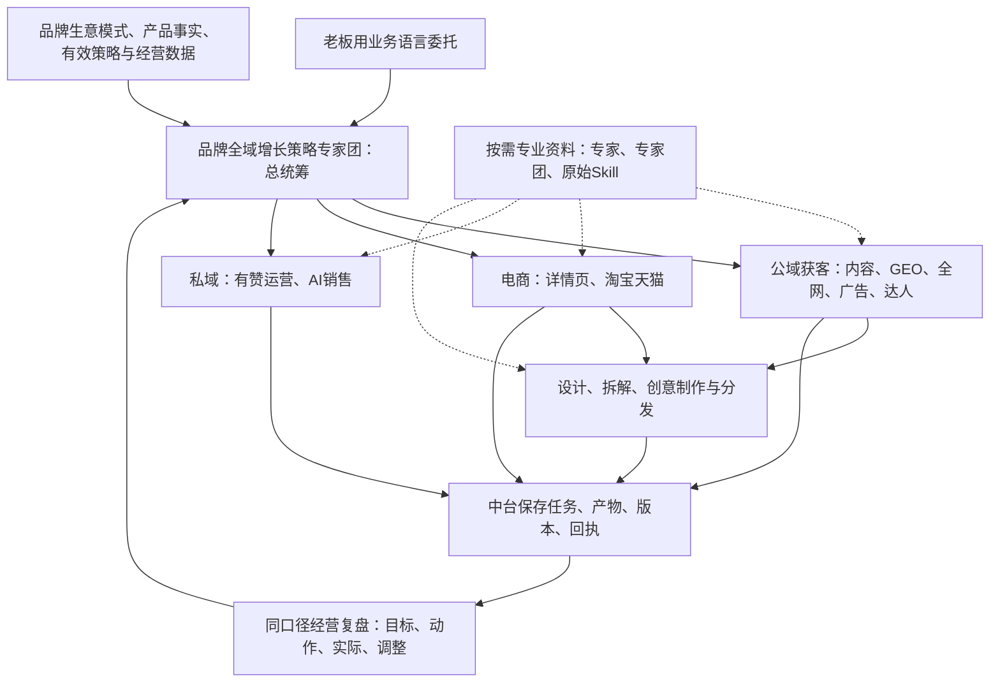

# 结构化分工与权威来源

总统筹不是只写报告：要判断各业务为什么做、先后依赖、承接能力和资源取舍。领域专家负责专业判断，工艺技能负责制作；中台负责本品牌共同事实、状态及证据。

## 四种东西分开管理

|内容|真源|进入新机的方式|
|---|---|---|
|通用方法与分工|本仓skills/registry|版本化安装，按需加载|
|专家/专家团/技能来源|公开来源卡及目录；原文在授权来源|先导航，再按授权核读必要原源，不将目录当全文|
|品牌资料、客户、经营策略与真实结果|本品牌中台/业务工程|通过本品牌已授权连接读取；不复制到通用Git|
|供应商能力、账号与授权|当前客户端连接器与供应商实际权限|新机独立配置、发现schema并只读核验；不随技能搬密钥|

## 专业知识的责任与适用范围

registry/experts.json登记原角色的领域导航职责、出处和领域入口；registry/original-skills.json登记原技能的阶段、包内角色与活跃入口。自动分类用于导航，不证明全部原方法已审定或某专家已被执行。

公开来源卡标明通用、品牌/历史和镜像范围。原始私有全文不在公开仓；必要时在授权来源核读，保留版本和读取证据。用户指定某品牌/某IP时才读取其专属偏好。

原专家自称可以调用工具，不证明本机具备该工具。原文固定“必须调用所有专家”、历史发布调度和开放网络权限不能覆盖当前用户和宿主规则。本库没有偷偷把原正式WorkBuddy专家替换成新角色，也没有绑定一个强制Ontology流程。

## 更新只有一个方法真源

后续通用方法先改本仓，经测试/版本记录后同步GitHub，再更新其他电脑的受管安装。Lab接口变化需要独立代码范围处理，本仓只记录兼容要求；中台下载包/WorkBuddy副本如仍保留，必须显式发布/比对，不声称本库推送已使所有旧副本自动更新。

既有在途任务保留原采用版本。方法变更需检查其是否影响当前输入、交接和既有批准；不重放已发布或已花费的动作。

## 安装维护入口（用户明确要求新增）

`00-omni-system-setup` 排在技能列表首位，负责安装、更新、备份与验收；它不改变品牌增长总统筹、领域职责或业务阶段。用户直接交给 Codex 执行；新机网络、Docker、模型配置和真实服务验收仍需当地条件。

## 经营反馈学习入口（用户明确新增）

`omni-growth-learning` 串联真实反馈、多种解释、用户选择、验证和经验分层；`omni-skill-maintenance` 仍负责领域方法、测试与发布。它是维护/测量协作能力，不改变业务总统筹或原业务阶段。
